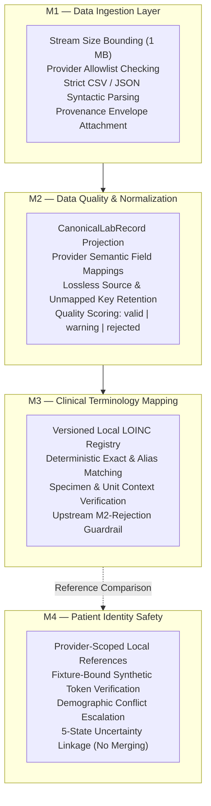
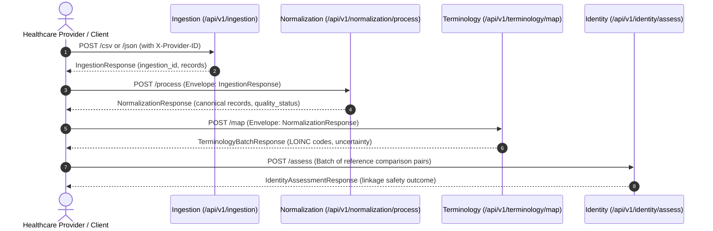

# TN HealthBridge — An Uncertainty-Aware Healthcare Interoperability Framework for ABDM-Aligned Data Exchange

[](file:///d:/Projects/TN-HealthBridge/pyproject.toml)
[](file:///d:/Projects/TN-HealthBridge/LICENSE)
[](file:///d:/Projects/TN-HealthBridge/docs/TESTING.md)

---

## 1. Project Title & Overview

**TN HealthBridge** is an open-source academic research prototype and interoperability middleware designed to enable heterogeneous, autonomous healthcare providers (e.g., regional hospitals, outpatient centers, clinical diagnostics laboratories) to exchange structured clinical data safely and reliably.

The framework aligns with national digital health interoperability principles—specifically India's **Ayushman Bharat Digital Mission (ABDM)**—while introducing explicit uncertainty-aware mechanisms. It treats clinical data quality, terminology ambiguity, and patient identity resolution as first-class uncertainty states, actively preventing dangerous silent errors, lossy data conversions, and unsafe automated identity merges.

---

## 2. Research Motivation & Problem Statement

In modern healthcare ecosystems, cross-institutional data exchange faces three core structural hazards:

1. **Heterogeneity vs. Forced Centralization:** Existing approaches often demand that all participants conform to a single centralized database or replace their legacy Hospital Information Systems (HIS) and Laboratory Information Systems (LIS). This infringes on provider data sovereignty and introduces systemic single points of failure.
2. **Clinical Terminology Conflation:** Naive automated terminology translation frequently applies loose fuzzy string matching or performs unvalidated unit conversions across incompatible physical properties (e.g., conflating mass concentration in $\text{mg/dL}$ with molar substance concentration in $\text{mmol/L}$), creating catastrophic medication and diagnostic risks.
3. **Identity Resolution Hazards:** Local hospital identifiers (such as Medical Record Numbers) collide across different facilities. When automated record linkage engines rely on simplistic demographic matching without cryptographic or explicit trust-binding, unrelated patient records are erroneously merged, permanently corrupting clinical histories.

---

## 3. Project Objectives

- **Decentralized Interoperability:** Enable secure clinical data exchange across independent healthcare providers without introducing a central patient database.
- **Explainable Data Quality:** Project heterogeneous vendor records into a standardized canonical laboratory schema while losslessly preserving all original fields and flagging quality issues (`valid`, `warning`, `rejected`).
- **Deterministic Terminology Mapping:** Standardize clinical test names to authoritative concepts (LOINC) using strict contextual constraints (biological specimen and unit verification) and an explicit human review escalation pathway.
- **Uncertainty-Aware Patient Identity Safety:** Scope local identifiers strictly to provider contexts, require authorized synthetic fixture trust-binding for positive linkage, and eliminate hazardous automated record merging.
- **Reproducible Academic Prototype:** Maintain an auditable, well-tested Python codebase with 100% passing automated tests.

---

## 4. What TN HealthBridge Does and Does Not Do

### What TN HealthBridge Does:
- Ingests tabular CSV uploads and structured JSON payloads from authorized healthcare providers.
- Projects heterogeneous observation keys into a canonical laboratory schema (`CanonicalLabRecord`).
- Normalizes datatypes and ISO-8601 timestamps without fabricating artificial midnight times or time zones.
- Resolves test names deterministically against a versioned local LOINC registry.
- Withholds standard terminology mapping on records rejected by upstream data quality checks.
- Scopes patient references to their originating provider (e.g. `HOSPITAL_A / SYN001` vs `HOSPITAL_B / SYN001`).
- Assesses identity linkage safety using a 5-state uncertainty engine (`same_identity`, `different_identity`, `possible_match`, `unresolved`, `review_required`).
- Processes records purely in-memory with zero disk persistence of clinical payloads.

### What TN HealthBridge Does NOT Do:
- **No Central Clinical Database:** It does not persist patient medical records, clinical observations, or identity mappings to a database (SQL, NoSQL, or local SQLite).
- **No Automated Record Merging:** It evaluates linkage safety between references; it never merges, overwrites, or combines patient charts.
- **No Fuzzy Equivalence:** It never uses phonetic algorithms, edit-distance heuristics, or probabilistic embeddings to guess clinical concepts.
- **No Automatic Unit Conversion:** It never guesses mathematical formulas to convert between mass concentrations and molar units.
- **No Real ABHA / ABDM Gateway:** It is a research simulation that does not connect to the live Government of India ABDM production network or live ABHA identity servers.
- **No Standalone Cryptographic Authentication:** In this prototype stage, provider allowlists check declared IDs, but do not yet verify mutual TLS or digital signatures.

---

## 5. M1–M4 Module Overview



Detailed specifications for each module are documented in:
- [M1 Data Ingestion](file:///d:/Projects/TN-HealthBridge/docs/modules/M1_DATA_INGESTION.md)
- [M2 Data Quality & Normalization](file:///d:/Projects/TN-HealthBridge/docs/modules/M2_DATA_NORMALIZATION.md)
- [M3 Clinical Terminology Mapping](file:///d:/Projects/TN-HealthBridge/docs/modules/M3_TERMINOLOGY_MAPPING.md)
- [M4 Patient Identity Safety](file:///d:/Projects/TN-HealthBridge/docs/modules/M4_PATIENT_IDENTITY_SAFETY.md)

---

## 6. Architecture & Data Flow

Callers invoke modular HTTP endpoints in sequence. Output envelopes from upstream stages serve as validated inputs to downstream stages:



For in-depth architectural diagrams and trust boundaries, see:
- [System Overview](file:///d:/Projects/TN-HealthBridge/docs/architecture/SYSTEM_OVERVIEW.md)
- [End-to-End Data Flow](file:///d:/Projects/TN-HealthBridge/docs/architecture/DATA_FLOW.md)
- [Module Dependencies](file:///d:/Projects/TN-HealthBridge/docs/architecture/MODULE_DEPENDENCIES.md)

---

## 7. Technology Stack

- **Language & Runtime:** Python 3.11 / 3.12
- **Web Framework:** [FastAPI](https://fastapi.tiangolo.com/) (High-performance, async REST API)
- **ASGI Server:** [Uvicorn](https://www.uvicorn.org/) (Standard async worker implementation)
- **Data Validation & Schemas:** [Pydantic v2](https://docs.pydantic.dev/) and `pydantic-settings`
- **Testing & Quality Assurance:** [pytest](https://pytest.org/), [httpx](https://www.python-httpx.org/), [pytest-cov](https://pytest-cov.readthedocs.io/)
- **Standard Vocabularies:** LOINC (Logical Observation Identifiers Names and Codes) v2.76 compatibility profile

---

## 8. Supported Input Formats & Endpoints

| Endpoint | HTTP Method | Content-Type | Supported Providers | Description |
| :--- | :---: | :--- | :--- | :--- |
| `/health` | `GET` | `application/json` | Public / System | Verifies system health and active modules. |
| `/api/v1/ingestion/csv` | `POST` | `multipart/form-data` | `HOSPITAL_A` | Ingests CSV files, bounding stream size to 1 MB. |
| `/api/v1/ingestion/json` | `POST` | `application/json` | `HOSPITAL_B`, `LAB_C` | Ingests structured JSON clinical record payloads. |
| `/api/v1/normalization/process` | `POST` | `application/json` | All Providers | Projects M1 envelope into `CanonicalLabRecord` schema. |
| `/api/v1/terminology/map` | `POST` | `application/json` | All Providers | Deterministically maps normalized tests to LOINC concepts. |
| `/api/v1/identity/assess` | `POST` | `application/json` | All Providers | Assesses patient identity linkage safety across references. |

---

## 9. Installation and Setup

### 9.1 Prerequisites
- Python 3.11 or 3.12 installed on your system.
- Git for source control management.

### 9.2 Clone Repository
```bash
git clone https://github.com/your-org/TN-HealthBridge.git
cd TN-HealthBridge
```

### 9.3 Create and Activate Virtual Environment

**On Windows (PowerShell):**
```powershell
python -m venv .venv
.\.venv\Scripts\Activate.ps1
```

**On Linux / macOS (Bash / Zsh):**
```bash
python3 -m venv .venv
source .venv/bin/activate
```

### 9.4 Install Dependencies

Install core runtime dependencies:
```bash
pip install -r requirements.txt
```

Install development and test dependencies:
```bash
pip install -r requirements-dev.txt
```

---

## 10. Configuration & Environment Variables

Copy the provided environment template to `.env`:
```bash
cp .env.example .env
```

Configuration defaults are managed in `app/core/config.py`:
- `ENVIRONMENT`: `development`
- `MAX_UPLOAD_SIZE_BYTES`: `1048576` (1 MB stream cap)
- `MAX_RECORD_COUNT`: `1000` (Max records per batch)
- `ALLOWED_PROVIDERS`: `["HOSPITAL_A", "HOSPITAL_B", "LAB_C"]`
- `DEFAULT_TERMINOLOGY_REGISTRY_PATH`: `data/terminology/default_registry.json`
- `SYNTHETIC_IDENTITY_REGISTRY_PATH`: `data/identity/synthetic_identity_registry.json`
- `SYNTHETIC_LINKAGE_FIXTURES_PATH`: `data/identity/synthetic_linkage_fixtures.json`

---

## 11. Running the Application Locally

Start the local Uvicorn development server:

```bash
uvicorn app.main:app --reload --host 127.0.0.1 --port 8000
```

### Accessing Interactive OpenAPI Documentation
Once started, navigate to your browser:
- **Interactive Swagger UI:** [http://127.0.0.1:8000/docs](http://127.0.0.1:8000/docs)
- **ReDoc UI:** [http://127.0.0.1:8000/redoc](http://127.0.0.1:8000/redoc)
- **Raw OpenAPI Specification:** [http://127.0.0.1:8000/openapi.json](http://127.0.0.1:8000/openapi.json)

---

## 12. Running Automated Tests

Run the complete test suite using `pytest`:

```bash
pytest -v
```

### Verified Test Suite Baseline
The current test suite consists of **162 unit and integration tests, 100% passing**:

```text
======================= 162 passed in 3.61s =======================
```

To run individual module test suites:
```bash
pytest tests/test_ingestion.py -v       # 22 passing tests (M1)
pytest tests/test_normalization.py -v   # 33 passing tests (M2)
pytest tests/test_terminology.py -v     # 33 passing tests (M3)
pytest tests/test_identity.py -v        # 74 passing tests (M4)
```

See [Testing Guide](file:///d:/Projects/TN-HealthBridge/docs/TESTING.md) for coverage analysis and test conventions.

---

## 13. End-to-End API Usage Example (Synthetic Data)

### Step 1: Health Check
```bash
curl -X GET http://127.0.0.1:8000/health
```

### Step 2: Ingest CSV Clinical Records (Hospital A)
```bash
curl -X POST http://127.0.0.1:8000/api/v1/ingestion/csv \
  -H "X-Provider-ID: HOSPITAL_A" \
  -F "file=@data/samples/hospital_a.csv"
```

### Step 3: Assess Patient Identity Linkage Safety (M4)
```bash
curl -X POST http://127.0.0.1:8000/api/v1/identity/assess \
  -H "Content-Type: application/json" \
  -d '{
    "comparisons": [
      {
        "comparison_id": "CMP-DEMO-001",
        "left_reference": {
          "source_provider_id": "HOSPITAL_A",
          "patient_reference": "SYN_PATIENT_001",
          "identity_token": "SYN_LINK_TOKEN_ALPHA_001",
          "demographics": {
            "full_name": "Ravi Kumar",
            "date_of_birth": "1985-06-15",
            "gender": "male"
          }
        },
        "right_reference": {
          "source_provider_id": "HOSPITAL_B",
          "patient_reference": "SYN_PATIENT_002",
          "identity_token": "SYN_LINK_TOKEN_ALPHA_001",
          "demographics": {
            "full_name": "Ravi Kumar",
            "date_of_birth": "1985-06-15",
            "gender": "male"
          }
        }
      }
    ]
  }'
```

*Expected JSON Outcome:*
```json
{
  "batch_id": "...",
  "total_comparisons": 1,
  "same_identity_count": 1,
  "different_identity_count": 0,
  "possible_match_count": 0,
  "review_required_count": 0,
  "unresolved_count": 0,
  "evaluations": [
    {
      "comparison_id": "CMP-DEMO-001",
      "outcome": "same_identity",
      "confidence": 1.0,
      "reason_code": "STRONG_TOKEN_MATCH",
      "details": "Authorized synthetic linkage fixture verified across distinct provider contexts without demographic conflicts."
    }
  ]
}
```

For complete endpoint contracts and schemas, see the [API Reference](file:///d:/Projects/TN-HealthBridge/docs/api/API_REFERENCE.md).

---

## 14. Repository Structure

```text
TN-HealthBridge/
├── README.md                      # Primary project overview and setup instructions
├── LICENSE                        # Academic prototype licensing notice & maintainer guidance
├── SECURITY.md                    # Vulnerability reporting & synthetic scope notice
├── .gitignore                     # Git exclusion rules for Python, virtualenvs, & IDEs
├── .gitattributes                 # Cross-platform LF line ending normalizations
├── requirements.txt               # Production runtime dependencies
├── requirements-dev.txt           # Testing and development dependencies
├── pyproject.toml                 # Packaging metadata and pytest configuration
├── .env.example                   # Environment variable template
│
├── app/                           # Core application package
│   ├── __init__.py
│   ├── main.py                    # Application factory, lifespan, & exception handlers
│   ├── api/                       # API route controllers
│   │   ├── __init__.py
│   │   ├── ingestion.py           # M1 endpoints: /api/v1/ingestion/csv & /json
│   │   ├── normalization.py       # M2 endpoint: /api/v1/normalization/process
│   │   ├── terminology.py         # M3 endpoint: /api/v1/terminology/map
│   │   └── identity.py            # M4 endpoint: /api/v1/identity/assess
│   ├── core/                      # Configuration & domain error definitions
│   │   ├── __init__.py
│   │   ├── config.py              # Base Settings model & provider allowlist
│   │   ├── errors.py              # Domain exceptions & error codes
│   │   ├── normalization_config.py# Provider field mappings & alias policies
│   │   ├── terminology_config.py  # Terminology registry loader & validator
│   │   └── identity_config.py     # Authoritative synthetic identity loader
│   ├── schemas/                   # Strongly-typed Pydantic contract models
│   │   ├── __init__.py
│   │   ├── ingestion.py           # Ingestion envelopes & record schemas
│   │   ├── normalization.py       # CanonicalLabRecord & normalization responses
│   │   ├── terminology.py         # Terminology mapping requests & responses
│   │   └── identity.py            # Identity comparison requests & responses
│   └── services/                  # Stateless domain logic engines
│       ├── __init__.py
│       ├── ingestion_service.py   # Stream parser & allowlist validator
│       ├── normalization_service.py# Schema mapper, type coerces, & QA scoring
│       ├── terminology_service.py # LOINC matching & context constraint evaluator
│       └── identity_service.py    # Provider scoping, trust binding, & linkage safety
│
├── data/                          # Authoritative configuration fixtures & samples
│   ├── identity/                  # Synthetic identity subject & linkage fixture registries
│   │   ├── synthetic_identity_registry.json
│   │   └── synthetic_linkage_fixtures.json
│   ├── samples/                   # Synthetic test payloads
│   │   ├── hospital_a.csv
│   │   └── hospital_b.json
│   └── terminology/               # Versioned local LOINC mapping registry
│       └── default_registry.json
│
├── tests/                         # Automated pytest test suites
│   ├── __init__.py
│   ├── test_ingestion.py          # 22 tests for M1 ingestion
│   ├── test_normalization.py      # 33 tests for M2 normalization & QA
│   ├── test_terminology.py        # 33 tests for M3 terminology & context rules
│   └── test_identity.py           # 74 tests for M4 identity safety & linkage
│
├── docs/                          # Comprehensive technical documentation
│   ├── architecture/
│   │   ├── SYSTEM_OVERVIEW.md     # Architectural patterns & trust boundaries
│   │   ├── DATA_FLOW.md           # End-to-end data lifecycle & sequence flows
│   │   └── MODULE_DEPENDENCIES.md # Inter-module coupling & schema contracts
│   ├── modules/
│   │   ├── M1_DATA_INGESTION.md   # M1 functional specification
│   │   ├── M2_DATA_NORMALIZATION.md # M2 functional specification
│   │   ├── M3_TERMINOLOGY_MAPPING.md # M3 functional specification
│   │   └── M4_PATIENT_IDENTITY_SAFETY.md # M4 functional specification
│   ├── api/
│   │   └── API_REFERENCE.md       # Complete REST API reference manual
│   ├── security/
│   │   └── SECURITY_AND_PRIVACY.md# Privacy policies & threat boundaries
│   ├── research/
│   │   └── SCOPE_AND_LIMITATIONS.md# Research scope & planned roadmap
│   ├── DEVELOPMENT.md             # Developer environment setup guide
│   ├── TESTING.md                 # Testing guide & verification matrix
│   └── CHANGELOG.md               # Version history and release notes
│
└── .github/                       # GitHub repository automation & community health
    ├── workflows/
    │   └── tests.yml              # Automated CI workflow running pytest on 3.11/3.12
    ├── ISSUE_TEMPLATE/
    │   ├── bug_report.md
    │   └── feature_request.md
    └── pull_request_template.md
```

---

## 15. Security, Privacy & Research Limitations

- **Academic Prototype Only:** TN HealthBridge is an academic and research prototype. It is not approved as medical device software or a certified production Health Repository (HIP/HIU).
- **Synthetic Data Exclusively:** Do not ingest real protected health information (PHI) into this prototype without enterprise security hardening.
- **Provider Allowlist Limitation:** In the current release, provider identity is established via allowlist checking of caller-supplied IDs (`X-Provider-ID`). Production environments must deploy mutual TLS (mTLS) with national health certificates.
- **Zero In-Memory Spooling:** While Starlette spools large files temporarily if needed, file descriptors are explicitly purged in `finally` blocks upon parsing.
- See [Security and Privacy](file:///d:/Projects/TN-HealthBridge/docs/security/SECURITY_AND_PRIVACY.md) and [Scope and Limitations](file:///d:/Projects/TN-HealthBridge/docs/research/SCOPE_AND_LIMITATIONS.md) for further details.

---

## 16. Current Implementation Status & Roadmap

| Module | Name | Status | Verified Tests |
| :--- | :--- | :---: | :---: |
| **M1** | Data Ingestion Gateway | **Implemented** | 22 |
| **M2** | Data Quality and Normalization | **Implemented** | 33 |
| **M3** | Clinical Terminology Mapping | **Implemented** | 33 |
| **M4** | Patient Identity Safety and Linkage | **Implemented** | 74 |
| **Total** | **Active Test Baseline** | **100% Passing** | **162** |
| **M5** | FHIR R4 Bundle Assembly | *Planned (Not Implemented)* | 0 |
| **M6** | Consent & ABDM Security Gateway | *Planned (Not Implemented)* | 0 |
| **M7** | Inter-Provider Secure Delivery | *Planned (Not Implemented)* | 0 |
| **M8** | Federated Audit & Compliance | *Planned (Not Implemented)* | 0 |

---

## 17. Contribution Guidelines

We welcome research contributions that enhance clinical data interoperability, expand standard LOINC/SNOMED CT mapping registries, and strengthen identity uncertainty safety.

1. Fork the repository and create a feature branch (`git checkout -b feature/clinical-concept-expansion`).
2. Adhere to core architectural rules:
   - **Do not introduce a database** or persistent clinical storage.
   - **Do not execute automatic patient record merges**.
   - **Use synthetic data exclusively** for test fixtures.
3. Verify that all 162 existing tests pass:
   ```bash
   pytest -v
   ```
4. Open a Pull Request using the provided [Pull Request Template](file:///d:/Projects/TN-HealthBridge/.github/pull_request_template.md).

---

## 18. Licensing

This project is currently distributed as an academic research prototype. Please refer to [LICENSE](file:///d:/Projects/TN-HealthBridge/LICENSE) for licensing status, intellectual property notices, and guidance for repository maintainers regarding open-source license selection (e.g., Apache 2.0 / MIT).
