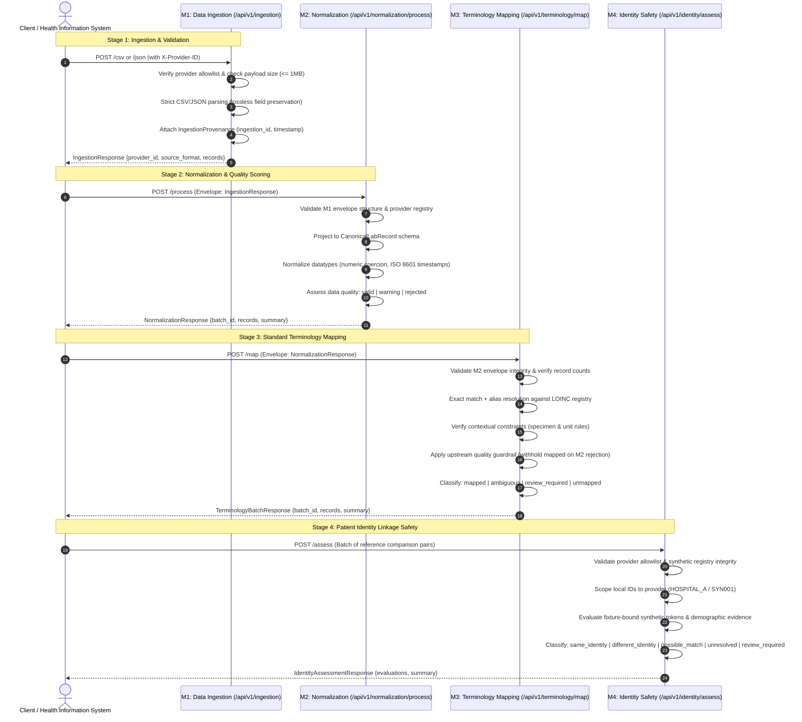

# End-to-End Data Flow

## 1. Architectural Sequence Overview

The TN HealthBridge framework processes clinical records through a logical sequence of four independent, stateless stages:

$$\text{M1: Ingestion} \longrightarrow \text{M2: Normalization} \longrightarrow \text{M3: Terminology Mapping} \longrightarrow \text{M4: Identity Assessment}$$

In the current implementation, each module is exposed as an autonomous HTTP endpoint. The sequence represents a **logical processing workflow** where an orchestrator or external client passes the output envelope of one stage as the input payload of the next.



---

## 2. Stage-by-Stage Processing Details

### Stage 1: Data Ingestion (M1)
- **Input:** Raw CSV file (`multipart/form-data`) or structured JSON payload (`application/json`).
- **Validation:**
  - Inbound stream size checked against `MAX_UPLOAD_SIZE_BYTES` (default 1 MB).
  - Source provider checked against `ALLOWED_PROVIDERS` (`HOSPITAL_A`, `HOSPITAL_B`, `LAB_C`).
  - Provider header (`X-Provider-ID`) and body parameters verified for consistency (conflicts rejected with `400 Bad Request`).
  - CSV parsing strictly checks consistent column counts and rejects duplicate header names.
  - JSON parsing enforces structured records and caps batch volume (`MAX_RECORD_COUNT = 1,000`).
- **Output:** Standardized `IngestionResponse` containing:
  - `ingestion_id`: Server-generated UUIDv4.
  - `source_provider_id`: Verified provider identifier.
  - `source_format`: `"csv"` or `"json"`.
  - `ingested_at`: UTC ISO-8601 timestamp.
  - `records`: List of records preserving all raw field names and string/native values without premature alteration.

---

### Stage 2: Data Quality & Normalization (M2)
- **Input:** Standardized `IngestionResponse` envelope from M1.
- **Processing:**
  - Validates envelope schema, ensuring ingestion provenance is present.
  - Retrieves configured provider profile (`Hospital A`, `Hospital B`, or `Lab C`).
  - Maps source keys (e.g., `patient_id` or `patient_reference`, `test_name` or `investigation`, `result` or `value`) into canonical `CanonicalLabRecord` fields.
  - Preserves unrecognized source keys in `unmapped_fields` and all original fields in `source_data`.
  - Normalizes numeric results (rejecting booleans, `NaN`, `Infinity`, and numeric overflow strings like `"1e999"`).
  - Normalizes timestamps to ISO-8601 (preserving date-only values without fabricating artificial times).
  - Evaluates record quality:
    - `valid`: All required fields present and valid; no warnings or issues.
    - `warning`: Optional fields missing, unmapped vendor keys present, or non-critical anomalies detected.
    - `rejected`: Missing required fields (`patient_reference`, `test_name`, `result`), unparseable numbers, or conflicting aliases.
- **Output:** `NormalizationResponse` containing canonical records, preserved sources, quality status, issue codes, and summary counts (`valid_records`, `warning_records`, `rejected_records`).

---

### Stage 3: Clinical Terminology Mapping (M3)
- **Input:** `NormalizationResponse` envelope from M2.
- **Processing:**
  - Enforces envelope integrity, non-empty batches, and record count reconciliation.
  - Evaluates each record against the versioned local terminology registry (`data/terminology/default_registry.json`).
  - **Deterministic Policy:**
    1. Exact match on test name (provider-specific mappings take precedence over global).
    2. Explicit configured alias match.
    3. Context evaluation: verifies biological `specimen` constraints and `unit` constraints.
    4. Guardrail: If record has `quality_status="rejected"`, terminology assignment is withheld and routed to `review_required` with `UPSTREAM_QUALITY_REJECTION`.
    5. Ambiguity: If multiple distinct standard concepts match, classified as `ambiguous` with target codes set to `None`.
    6. Unmapped: If no configured mapping matches test name or aliases.
- **Output:** `TerminologyBatchResponse` containing preserved records, enriched `terminology_mapping` metadata, and batch reconciliation statistics.

---

### Stage 4: Patient Identity Linkage Safety (M4)
- **Input:** `IdentityAssessmentBatchRequest` containing comparison pairs of synthetic patient references (`left_reference`, `right_reference`).
- **Processing:**
  - Validates provider references against `ALLOWED_PROVIDERS`.
  - Confirms references against the authoritative synthetic identity registry (`data/identity/synthetic_identity_registry.json`).
  - Enforces **provider-scoped local references**: identical string IDs from different providers are treated as different individuals by default.
  - Checks authorized synthetic linkage fixtures (`data/identity/synthetic_linkage_fixtures.json`): tokens only confer linkage if explicitly bound to the synthetic subject authorized to represent both references.
  - Evaluates demographic signals (name, DOB, gender) and detects conflicts.
  - Produces deterministic, explainable safety outcomes:
    - `same_identity`: Valid provider contexts and authorized strong synthetic token binding.
    - `different_identity`: Confirmed distinct registered subjects or explicit conflicting identifiers.
    - `possible_match`: Demographic agreement without strong token evidence (never merged).
    - `review_required`: Conflicting demographic or token signals requiring human review.
    - `unresolved`: Insufficient evidence to establish linkage.
- **Output:** `IdentityAssessmentResponse` containing pair-level safety evaluations, confidence scores, explainable reason codes, and batch summary counts.

---

## 3. Trust Boundaries & Privacy Enforcement

```mermaid
flowchart TD
    subgraph ExternalBoundary [Untrusted External Boundary]
        RawData[Raw CSV / JSON Payloads]
        CallerHeaders[Caller-Supplied X-Provider-ID]
    end

    subgraph InternalBoundary [Stateless Middleware Trust Boundary]
        M1_In[Stream Guard & Provider Allowlist]
        M2_Norm[Type Normalization & Sanitized Issue Codes]
        M3_Term[Deterministic Registry Match & Guardrails]
        M4_Ident[Authorized Fixture Trust-Binding & Scoping]
    end

    subgraph PersistenceBoundary [Data Persistence Boundary]
        NoDB[Central Clinical DB: NONE<br/>Patient Identity Index: NONE<br/>Disk Spooling: NONE (Immediate Purge)]
    end

    RawData --> M1_In
    CallerHeaders --> M1_In
    M1_In --> M2_Norm --> M3_Term --> M4_Ident
    M4_Ident -. Zero Persistence .-> NoDB
```

1. **Provider Allowlist Boundary:** Caller-supplied headers and payload IDs are checked against configured allowlists (`ALLOWED_PROVIDERS`), but are not treated as cryptographically authenticated identity in the absence of mutual TLS / PKI (planned for M6/M7).
2. **Clinical Privacy Boundary:** Log statements never output raw clinical results, patient demographics, or unredacted patient identifiers. Error messages sanitize input values to avoid leaking sensitive data in HTTP responses.
3. **Stateless Lifetime:** No clinical data or patient records are retained on disk or committed to a database. Memory allocated for request processing is released upon completion of the HTTP lifecycle.
