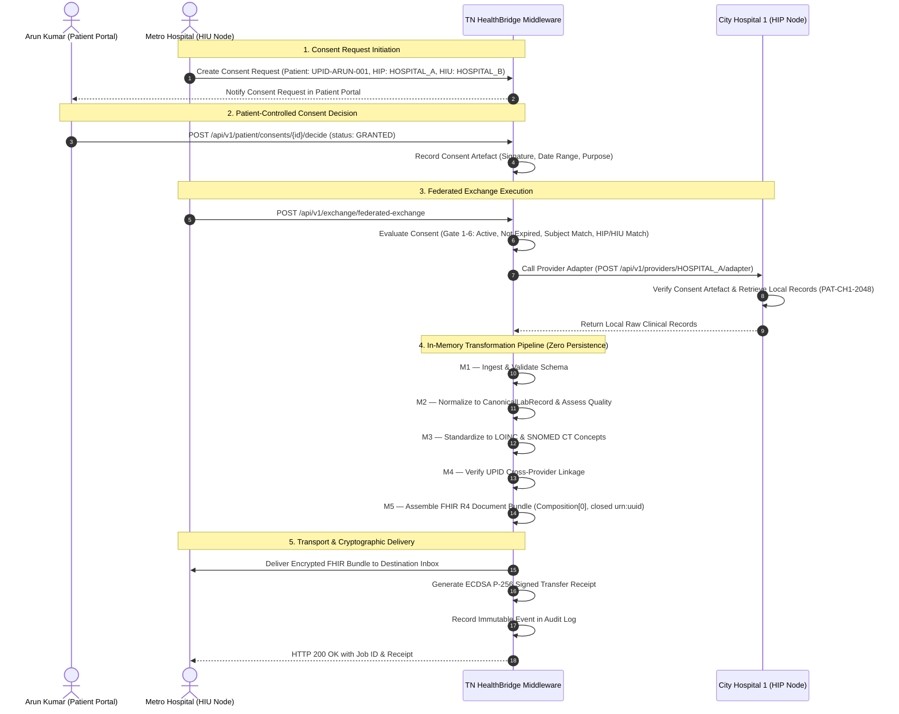

# TN HealthBridge Architecture & Federated Data Flow

This document outlines the end-to-end data flow, module interactions (M1–M7), and security controls governing federated healthcare data exchange across connected healthcare provider nodes.

---

## 1. High-Level Architecture Topology

```mermaid
flowchart TB
    subgraph Clients [User Applications & Portals]
        AdminApp["Admin Portal<br/>(Transfers, UPID, Orgs, Audit)"]
        PatientApp["Patient Portal<br/>(Profile, Records, Consent Decision)"]
        HospitalNodes["6 Federated Provider Nodes<br/>(City Hosp 1, Central Lab, Metro, Sunrise, Elite, Green Valley)"]
    end

    subgraph Middleware [TN HealthBridge Middleware (Strict Non-Persistence)]
        Auth["Security Gateway & RBAC (JWT HS256)"]
        UPID_Engine["Universal Patient Identity (UPID)<br/>+ M4 Uncertainty-Aware Linkage"]
        Consent_Engine["ABDM Consent Gateway (M5/M6)<br/>6 Validation Release Gates"]
        Pipeline["M1 Ingestion ➔ M2 Normalization ➔ M3 Terminology ➔ M5 FHIR Assembly"]
        Exchange_Engine["M7 Federated Exchange & Transport<br/>(ECDSA P-256 Signed Receipts, Idempotency)"]
        Audit_Log["Immutable Audit Journal (SHA-256 Chained)"]
    end

    subgraph NodeStorage [Provider-Local Isolated Tenant Repositories]
        RepoA["City Hospital 1 Data<br/>(data/providers/HOSPITAL_A/)"]
        RepoB["Metro Hospital Data<br/>(data/providers/HOSPITAL_B/)"]
        RepoC["Central Lab Data<br/>(data/providers/LAB_C/)"]
        RepoD["Sunrise Hosp Data<br/>(data/providers/HOSPITAL_D/)"]
        RepoE["Elite Diag Data<br/>(data/providers/LAB_E/)"]
        RepoF["Green Valley Clinic Data<br/>(data/providers/CLINIC_F/)"]
    end

    Clients --> Auth
    Auth --> Consent_Engine
    Auth --> UPID_Engine
    Consent_Engine --> Pipeline
    Pipeline --> Exchange_Engine
    Exchange_Engine --> Audit_Log

    Pipeline <--> NodeStorage
    Exchange_Engine -. Delivers FHIR Bundle .-> RepoB
```

---

## 2. End-to-End Federated Exchange Workflow

When a healthcare provider (e.g. Metro Hospital `HOSPITAL_B`) requests records from another provider (e.g. City Hospital 1 `HOSPITAL_A`) for patient Arun Kumar (`UPID-ARUN-001`):



---

## 3. Strict Clinical Data Non-Persistence Guarantee

TN HealthBridge strictly enforces non-persistence of clinical data in the middleware:
1. **Request-Scoped Transit:** Exchanged clinical payloads (raw JSON/CSV, canonical records, FHIR bundles) exist strictly in transient RAM memory during pipeline execution.
2. **Metadata Retention Only:** The middleware persists only transaction tracking metadata in `data/exchange/exchange_jobs.json`:
   - `job_id`, `idempotency_key`, `consent_id`, timestamps, status, cryptographic receipt.
3. **Decentralized Storage:** Patient medical records are owned by and remain isolated inside each provider's local tenant storage (`data/providers/{provider_id}/data.json`).
4. **On-Demand Federated Query:** When the patient views their medical history in the Patient Portal, records are fetched directly from connected provider nodes in real time, aggregated in-memory, and presented without retention.
