# Module Dependencies & Coupling Architecture

## 1. Overview

TN HealthBridge is structured to maintain **low inter-module coupling** and **high functional cohesion**. Each module (M1 through M4) operates autonomously through strongly-typed Pydantic schemas and stateless service classes.

```mermaid
graph TD
    subgraph Core [Shared Core Infrastructure]
        Config["app.core.config<br/>(Settings, ALLOWED_PROVIDERS)"]
        Errors["app.core.errors<br/>(Domain Exceptions & Error Codes)"]
        NormConfig["app.core.normalization_config<br/>(Provider Profiles, Field Mappings)"]
        TermConfig["app.core.terminology_config<br/>(Registry Loader & Validation)"]
        IdentConfig["app.core.identity_config<br/>(Synthetic Identity Registry & Fixtures)"]
    end

    subgraph Schemas [Pydantic Contract Schemas]
        S_M1["app.schemas.ingestion<br/>(IngestionResponse, IngestedRecord)"]
        S_M2["app.schemas.normalization<br/>(CanonicalLabRecord, NormalizationResponse)"]
        S_M3["app.schemas.terminology<br/>(TerminologyBatchResponse, MappedRecord)"]
        S_M4["app.schemas.identity<br/>(IdentityAssessmentBatchRequest, Response)"]
    end

    subgraph Services [Stateless Domain Services]
        Svc_M1["IngestionService<br/>(Stream parser, allowlist validator)"]
        Svc_M2["NormalizationService<br/>(Schema mapper, type coerces, QA)"]
        Svc_M3["TerminologyService<br/>(Registry match, context rules)"]
        Svc_M4["IdentityService<br/>(Scoping, trust-binding, uncertainty)"]
    end

    subgraph Endpoints [FastAPI API Routers]
        R_M1["app.api.ingestion<br/>POST /csv, POST /json"]
        R_M2["app.api.normalization<br/>POST /process"]
        R_M3["app.api.terminology<br/>POST /map"]
        R_M4["app.api.identity<br/>POST /assess"]
    end

    %% Dependencies
    Svc_M1 --> Config
    Svc_M1 --> Errors
    Svc_M1 --> S_M1

    Svc_M2 --> Config
    Svc_M2 --> NormConfig
    Svc_M2 --> Errors
    Svc_M2 --> S_M1
    Svc_M2 --> S_M2

    Svc_M3 --> Config
    Svc_M3 --> TermConfig
    Svc_M3 --> Errors
    Svc_M3 --> S_M2
    Svc_M3 --> S_M3

    Svc_M4 --> Config
    Svc_M4 --> IdentConfig
    Svc_M4 --> Errors
    Svc_M4 --> S_M4

    R_M1 --> Svc_M1
    R_M2 --> Svc_M2
    R_M3 --> Svc_M3
    R_M4 --> Svc_M4
```

---

## 2. Dependency Matrix

The table below outlines direct code and schema dependencies between components:

| Component | Depends On Core | Consumes Schemas From | Produces Schemas | Downstream Consumers |
| :--- | :--- | :--- | :--- | :--- |
| **M1 Ingestion** | `config`, `errors` | None (consumes raw HTTP payloads) | `app.schemas.ingestion.IngestionResponse` | M2 Normalization, External Clients |
| **M2 Normalization** | `config`, `errors`, `normalization_config` | `app.schemas.ingestion.IngestionResponse` | `app.schemas.normalization.NormalizationResponse` | M3 Terminology, External Clients |
| **M3 Terminology** | `config`, `errors`, `terminology_config` | `app.schemas.normalization.NormalizationResponse` | `app.schemas.terminology.TerminologyBatchResponse` | M4 Reference Extraction, M5 FHIR Assembly (Planned) |
| **M4 Identity Safety** | `config`, `errors`, `identity_config` | `app.schemas.identity.IdentityAssessmentBatchRequest` | `app.schemas.identity.IdentityAssessmentResponse` | Cross-Provider Exchange Workflows, M5 Bundling (Planned) |

---

## 3. Coupling Guardrails

To prevent architectural degradation, TN HealthBridge enforces the following coupling constraints:

1. **No Downstream-to-Upstream Coupling:** Upstream modules never import or reference downstream schemas. M1 has zero awareness of M2 canonical formats; M2 has zero awareness of M3 LOINC codes; M3 has zero awareness of M4 identity linkage tokens.
2. **Contract Preservation:** Intermediate stages communicate strictly via validated Pydantic model envelopes (`IngestionResponse` -> `NormalizationResponse` -> `TerminologyBatchResponse`).
3. **Registry Independence:**
   - Terminology mappings are driven by external JSON configuration (`data/terminology/default_registry.json`) loaded at service instantiation.
   - Synthetic identity registries and linkage fixtures are driven by JSON configuration (`data/identity/synthetic_identity_registry.json` and `synthetic_linkage_fixtures.json`) validated at application startup.
4. **Isolated Error Domains:** Each module inherits from base domain exceptions (`IngestionException`, `NormalizationException`, `TerminologyException`, `IdentityException`) mapped to specific HTTP status codes in centralized exception handlers.
