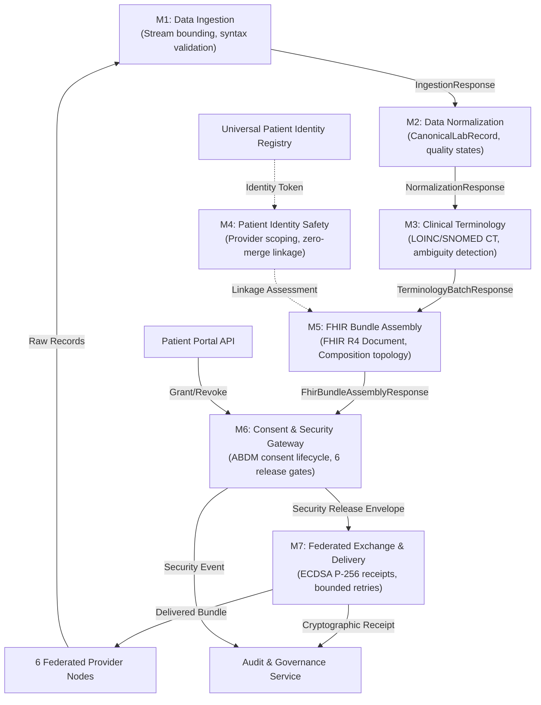

# TN HealthBridge Module Dependencies & Interoperability Architecture

This document formalizes the architectural contracts, data interfaces, and execution flow across the seven core modules (M1–M7) and auxiliary federation services.

---

## 1. Architectural Dependency Hierarchy

---

## 2. Module Specifications & Input/Output Contracts

### M1 — Data Ingestion
- **Input:** Raw CSV / JSON payload (`X-Provider-ID` header, max 1MB stream).
- **Processing:** Content-length enforcement, dialect detection, character encoding validation, provider allowlist verification.
- **Output:** `IngestionResponse` containing sanitized records, schema detection metadata, and SHA-256 ingress digest.

### M2 — Data Quality & Normalization
- **Input:** `IngestionResponse` envelope from M1.
- **Processing:** Semantic field mapping to `CanonicalLabRecord`, ISO-8601 timestamp parsing, numeric range validation, quality assessment (`valid`, `warning`, `rejected`).
- **Output:** `NormalizationResponse` with canonical laboratory records and per-record quality metrics.

### M3 — Clinical Terminology Mapping
- **Input:** `NormalizationResponse` envelope from M2.
- **Processing:** LOINC & SNOMED CT lookup against versioned local registry, specimen and unit constraint checking, measurement property conflict detection (mass vs substance concentration), upstream rejection isolation.
- **Output:** `TerminologyBatchResponse` with mapped codes, verification status, and ambiguity flags.

### M4 — Patient Identity Safety
- **Input:** Candidate patient references `(source_provider, local_patient_id)` and optional scoped synthetic trust token.
- **Processing:** Global provider-scoped registry validation, deterministic uncertainty evaluation without record merging.
- **Output:** `IdentityAssessmentResponse` (`same_identity`, `different_identity`, `possible_match`, `unresolved`, `review_required`) with confidence score and deterministic reason.

### M5 — FHIR R4 Bundle Assembly
- **Input:** `TerminologyBatchResponse` from M3.
- **Processing:** Document bundle construction adhering to FHIR R4, `Composition` as `entry[0]`, LOINC and UCUM coded elements, isolated patient identifiers, closed internal `urn:uuid:` reference topology.
- **Output:** `FhirBundleAssemblyResponse` containing the valid FHIR R4 Document Bundle JSON.

### M6 — Consent & Security Gateway
- **Input:** Assembled FHIR Bundle + ABDM Consent Artefact ID.
- **Processing:** Evaluation of 6 release gates (active status, temporal validity, HIU/HIP matching, subject matching, date range bounding, purpose code).
- **Output:** `SecurityReleaseEnvelope` containing permission grant status, cryptographic authorization token, and plain SHA-256 payload digest.

### M7 — Federated Exchange, Transport & Delivery
- **Input:** `SecurityReleaseEnvelope` + target hospital endpoint.
- **Processing:** Pre-dispatch revocation verification, idempotency checking, bounded exponential backoff on network failures, delivery to recipient provider inbox.
- **Output:** `ExchangeJob` with status (`completed`, `failed`, `cancelled`), delivery audit trail, and ECDSA P-256 digital signature receipt.
