# System Overview & Architecture

## 1. Project Title & Abstract

**TN HealthBridge — An Uncertainty-Aware Healthcare Interoperability Framework for ABDM-Aligned Data Exchange**

TN HealthBridge is an academic and research prototype exploring decentralized, uncertainty-aware healthcare data interoperability. It is designed to enable heterogeneous, autonomous healthcare providers (e.g., regional hospitals, outpatient centers, clinical diagnostics laboratories) to exchange structured clinical observations without constructing a centralized patient database, without forcing uniform local database schemas, and without executing risky automated identity merges.

The framework complements national digital health standards, specifically aligning with principles from India's **Ayushman Bharat Digital Mission (ABDM)**, by respecting provider-scoped identifiers, preserving clinical provenance, and modeling data quality and identity uncertainties as explicit first-class attributes.

---

## 2. High-Level Architectural Model

TN HealthBridge operates as a modular, stateless interoperability middleware. In the current implementation (v0.2.0), the system comprises four foundational modules (**M1 through M4**), each implemented as independent FastAPI endpoints and domain services.

```mermaid
flowchart TB
    subgraph HeterogeneousProviders [Autonomous Provider Systems]
        HA[Hospital A<br/>CSV Laboratory Exports]
        HB[Hospital B<br/>JSON Laboratory Payloads]
        LC[Lab C<br/>JSON Clinical Feeds]
    end

    subgraph TrustBoundary [Middleware Trust & Validation Boundary]
        direction TB
        subgraph M1_Layer [M1: Data Ingestion Layer]
            M1_EP["/api/v1/ingestion/csv<br/>/api/v1/ingestion/json"]
            M1_Val["Stream Size Guard (1MB)<br/>Provider Allowlist Verification<br/>Syntax & Structure Parsing"]
            M1_Env["IngestionResponse Envelope<br/>UUIDv4 Ingestion ID + UTC Timestamp"]
        end

        subgraph M2_Layer [M2: Data Quality & Normalization]
            M2_EP["/api/v1/normalization/process"]
            M2_Map["Provider Semantic Mappings<br/>CanonicalLabRecord Projection<br/>Type Coercion & Safe Datetime Handling"]
            M2_QA["Quality Assessment Engine<br/>Valid / Warning / Rejected<br/>Explicit Quality Issue Codes"]
        end

        subgraph M3_Layer [M3: Clinical Terminology Mapping]
            M3_EP["/api/v1/terminology/map"]
            M3_Reg["Versioned Local Registry (LOINC)<br/>Deterministic Matching (Exact + Aliases)"]
            M3_Ctx["Context Evaluation (Specimen + Units)<br/>Upstream Rejection Guardrail<br/>Mapped / Ambiguous / Review / Unmapped"]
        end

        subgraph M4_Layer [M4: Patient Identity Safety]
            M4_EP["/api/v1/identity/assess"]
            M4_Scope["Provider-Scoped Local References<br/>Fixture-Bound Synthetic Token Verification"]
            M4_Dec["Uncertainty-Aware Linkage Engine<br/>same_identity / different_identity<br/>possible_match / unresolved / review_required"]
        end
    end

    subgraph PlannedFuture [Planned Future Work — Modules M5 through M8]
        M5["M5: FHIR R4 Bundle Assembly<br/>(Not Yet Implemented)"]
        M6["M6: Consent & ABDM Security Gateway<br/>(Not Yet Implemented)"]
        M7["M7: Secure Inter-Provider Transfer<br/>(Not Yet Implemented)"]
        M8["M8: Federated Audit & Analytics<br/>(Not Yet Implemented)"]
    end

    HA -->|Multipart CSV| M1_EP
    HB -->|Application JSON| M1_EP
    LC -->|Application JSON| M1_EP

    M1_EP --> M1_Val --> M1_Env
    M1_Env -. Logical Chain / API Caller .-> M2_EP
    M2_EP --> M2_Map --> M2_QA
    M2_QA -. Logical Chain / API Caller .-> M3_EP
    M3_EP --> M3_Reg --> M3_Ctx
    M3_Ctx -. Synthetic Reference Extraction .-> M4_EP
    M4_EP --> M4_Scope --> M4_Dec

    M3_Ctx -. Future Pipeline .-> M5
    M4_Dec -. Future Linkage Metadata .-> M5
    M5 -.-> M6 -.-> M7 -.-> M8

    classDef implemented fill:#e8f5e9,stroke:#2e7d32,stroke-width:2px;
    classDef planned fill:#f5f5f5,stroke:#9e9e9e,stroke-width:1px,stroke-dasharray: 5 5;
    class M1_Layer,M2_Layer,M3_Layer,M4_Layer implemented;
    class PlannedFuture,M5,M6,M7,M8 planned;
```

> [!IMPORTANT]
> **Independent Execution Model:** The modules are deployed as discrete, modular endpoints. In the current prototype, callers invoke each endpoint sequentially (e.g., calling M1, forwarding the M1 response envelope to M2, forwarding M2 to M3, and assessing patient identity references in M4). There is no automated, hidden background pipeline runner orchestrating executions behind the scenes; data flow is explicit and caller-driven.

---

## 3. Implemented Modules vs. Planned Roadmap

The framework enforces a strict boundary between what is currently implemented, tested, and verifiable, and what is reserved for future research iterations.

| Module | Name | Status | Verified Tests | Primary Responsibility |
| :--- | :--- | :---: | :---: | :--- |
| **M1** | Data Ingestion | **Implemented** | 22 tests | Provider allowlist checking, stream size bounding, CSV/JSON syntactic validation, and ingestion provenance envelope attachment. |
| **M2** | Data Quality & Normalization | **Implemented** | 33 tests | Canonical laboratory schema projection, provider-specific field mapping, numeric normalization, ISO datetime validation, and tri-state quality scoring (`valid`, `warning`, `rejected`). |
| **M3** | Clinical Terminology Mapping | **Implemented** | 33 tests | Deterministic LOINC registry mapping, alias resolution, specimen/unit context constraint validation, upstream quality guardrails, and uncertainty classification. |
| **M4** | Patient Identity Safety | **Implemented** | 74 tests | Provider-scoped identity references, authorized synthetic fixture trust-binding, demographic conflict escalation, and zero-merge linkage safety assessment. |
| **M5** | FHIR R4 Bundle Assembly | *Planned* | 0 | Transformation of standardized canonical records into ABDM-compliant FHIR R4 DiagnosticReport and Observation bundles. |
| **M6** | Consent & ABDM Gateway | *Planned* | 0 | Integration with ABDM Consent Manager (HIP/HIU flow) and cryptographic assertion verification. |
| **M7** | Inter-Provider Delivery | *Planned* | 0 | Mutual TLS (mTLS) transport and peer-to-peer federated transfer protocol between hospitals. |
| **M8** | Federated Audit Logging | *Planned* | 0 | Privacy-preserving cryptographic audit trails and compliance verification across distributed nodes. |

---

## 4. Fundamental Architectural Principles

### 4.1 Zero Central Clinical Persistence
TN HealthBridge does **not** maintain a central database (no SQL, NoSQL, or local SQLite database). Clinical records pass through in-memory data structures during request processing and are returned directly in the response envelopes. Healthcare providers maintain absolute data sovereignty over their medical databases.

### 4.2 Non-Destructive In-Memory Transformation
At every stage (M1, M2, M3), raw source fields and unmapped vendor attributes are preserved losslessly in dictionary structures (`source_data` and `unmapped_fields`). Downstream consumers always retain access to the original clinical evidence without vendor lock-in or lossy translation.

### 4.3 Explicit Representation of Uncertainty
Instead of forcing binary decisions (e.g., forcing a questionable test to a standard code, or forcing two similar patients to be merged), TN HealthBridge explicitly surfaces uncertainty:
- **Data Quality (M2):** `valid`, `warning`, `rejected`.
- **Terminology (M3):** `mapped`, `ambiguous`, `review_required`, `unmapped`.
- **Identity Safety (M4):** `same_identity`, `different_identity`, `possible_match`, `unresolved`, `review_required`.

Records with ambiguous or conflicting signals are routed for explicit human or administrative review rather than silently corrupted.

### 4.4 Identity Safety: Assessment Without Merging
M4 evaluates whether two patient records in simulated exchange represent the same person. Crucially:
- It **never** executes automatic record merging.
- It **never** rewrites patient identifiers across providers.
- It scopes all local hospital IDs to their originating provider (e.g., `HOSPITAL_A / SYN001` vs `HOSPITAL_B / SYN001`).
- Association requires an explicitly configured, trusted synthetic linkage token bound to authorized references.
